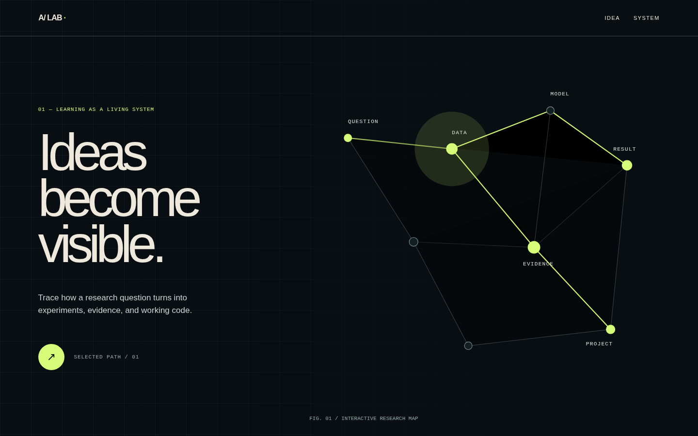
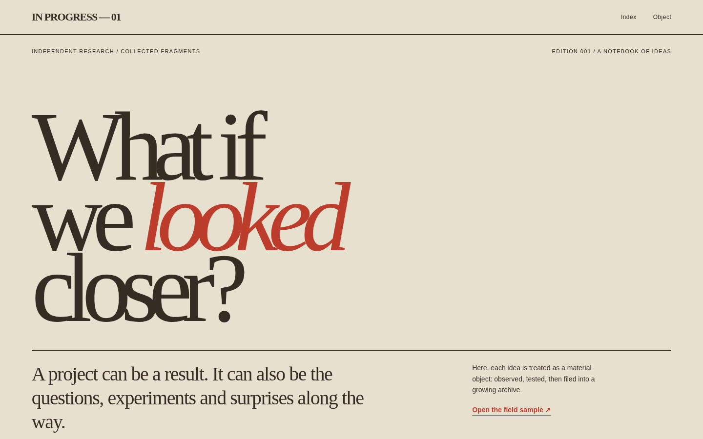

# Aestitch

**Discover your taste. Explore real art directions. Preserve design intent.**  
*Evidence-first design intelligence for coding agents · by Suatlora*

> **v0.3.1 preview:** Aestitch is a portable Agent Skill and a local Python CLI. It is **not** an autonomous aesthetic model: a human or vision-enabled agent must still interpret reference material, create concepts and judge the designs. It does not promise award-winning UI from a prompt. v0.3.1 is a reliability patch; the v0.4 Creative Guidance protocol is a draft, not an implemented CLI feature.

## Why it exists

Vibe coding can create maintainable web pages that still feel generic. Adding more reference links or prohibitions is often not enough: an agent can lose the original visual ideas during **reference observation → art direction → prototype → code handoff**. Aestitch makes those steps explicit and testable, while retaining the memory and code-change controls introduced in v0.2.

## What works in v0.3.1

| Capability | CLI commands | What it really does |
|---|---|---|
| Reference Observatory | `observe capture/report` | Visits a **trusted, explicitly supplied** localhost/remote URL or renders a local offline HTML file; saves viewport screenshots, scroll frames, DOM element geometry and computed font/color facts. New manifests record `capture_context` (viewport, reduced motion, disabled animations) and `evidence_scope`; this is static evidence, not proof that hover/motion was observed. |
| Art Direction Lab | `concept add/render/compare` | Stores independently **authored** HTML prototypes, renders desktop/mobile, flags identical prototypes, repeated mechanisms and near-identical landmark geometry. Repeated renders keep a history instead of overwriting the previous observation. Does not invent designs or rate beauty. |
| Visual handoff | `fidelity` | Compares one prototype's screenshot and anchors to a separately observed implementation at the same viewport. Reports differences, not implementation correctness or aesthetic quality. |
| Region-aware visual guard | `guard --top-viewport` | Compares first viewport of full-page screenshots even if page heights differ. Does not compare lower sections. |
| Contextual taste | `taste compare/report` | Can separately record **absolute acceptance** and **relative preference** (e.g. "neither accepted, but B is more refined"). No automatic style inference. |
| Experiment handoff | `experiment record/review/report` | Registers existing local evidence with hashes, an evidence class and the Skill commit; keeps Agent claims separate from a user-confirmed review. Nothing is uploaded. |
| Existing controls | `reference`, `record`, `brief`, `contract`, `scope`, `capture`, `doctor` | Local reference metadata, explicit preference memory, draft/approved design contracts, source-change budgets and screenshot baselines. |

The v0.4 **Creative Guidance protocol** is documented in [`skills/aestitch/references/creative-guidance.md`](skills/aestitch/references/creative-guidance.md) with minimal JSON examples. It describes triage, falsifiable hypotheses, two directions and preference elicitation; it does not add CLI commands in v0.3.1.

All project evidence is kept in `<target-project>/.aestitch/` and ignored by git by default. No login, external model API, vector database or telemetry is required. Aestitch itself does not modify the website source.

## Install / update (Windows PowerShell)

**Existing users** should pull new code rather than reclone the repository:

```powershell
cd F:\Projects\Aestitch-skill
git pull --ff-only
uv sync --extra all
uv run python -m playwright install chromium
uv run aestitch doctor
```

`aestitch doctor` must work when the script is executed directly; v0.3.1 fixes the
`importlib.util` crash that affected earlier direct runs.

### Agent Skill discovery

The canonical Skill source is `F:\Projects\Aestitch-skill\skills\aestitch`. Copy or
link that directory into the location your Agent actually reads:

| Agent | Typical location | Notes |
|---|---|---|
| Claude Code (user-level) | `C:\Users\<you>\.claude\skills\aestitch` | A directory symlink is convenient on Windows; otherwise copy and re-copy after updates. |
| Claude Code (project-level) | `<project>\.claude\skills\aestitch` | Use when the Skill should travel with one project. |
| Codex (project-level, as used in this workspace) | `<project>\.agents\skills\aestitch` | The repository's `skills/aestitch` is copied here. |

Example for a Codex project copy (review local edits first; do not overwrite them blindly):

```powershell
Copy-Item "F:\Projects\Aestitch-skill\skills\aestitch\*" `
  "F:\Projects\aestitch-lab-c\.agents\skills\aestitch" -Recurse -Force
```

Example for Claude Code user-level discovery:

```powershell
New-Item -ItemType Directory -Force "$HOME\.claude\skills" | Out-Null
# Prefer a symlink so updates to the canonical Skill are visible immediately:
New-Item -ItemType SymbolicLink -Path "$HOME\.claude\skills\aestitch" `
  -Target "F:\Projects\Aestitch-skill\skills\aestitch"
```

If you have not cloned yet, clone `https://github.com/kanannaku/Aestitch-skill` first. Python >=3.10 is required. Playwright/Chromium supports browser capture; Pillow supports image evidence. You can run `uv run --project F:\Projects\Aestitch-skill aestitch --root F:\Projects\YOUR-PROJECT ...` from anywhere. **The `--root` flag comes before the subcommand.**

## What the demo actually renders

These are real Chromium screenshots of two **small, original, self-contained concepts**, not AI beauty predictions. They intentionally vary their mechanism and composition; a user may reject both.

| Computational space (spatial research) | Editorial object (typography-first) |
|---|---|
|  |  |

## Quick experiment — original creative directions

Aestitch ships two **demonstration prototypes** that intentionally use different mechanisms, not just different colors. They are examples to exercise its evidence pipeline; they are not recommended UI templates.

From the Aestitch repository directory:

```powershell
uv run aestitch init
uv run aestitch concept add --id spatial --title "Computational space" --thesis "Research as navigable space" --mechanism "Interactive node graph" --html-file examples/creative-lab/computational-space.html
uv run aestitch concept add --id editorial --title "Editorial object" --thesis "Research as a printed object" --mechanism "Oversized typography and sampling" --html-file examples/creative-lab/editorial-object.html
uv run aestitch concept render --id spatial
uv run aestitch concept render --id editorial
uv run aestitch concept compare --left spatial --right editorial
```

Outputs: `.aestitch/observations/concept-spatial/`, `.aestitch/observations/concept-editorial/` and `.aestitch/reports/concept-spatial-vs-editorial-desktop.json`. If running again, use a new concept ID; registration never overwrites an earlier idea.

## Observe an actual web page

From a **target website project** whose dev server you have started on localhost:

```powershell
uv run --project F:\Projects\Aestitch-skill aestitch --root F:\Projects\aestitch-lab-c observe capture --id my-home --url http://127.0.0.1:3000 --viewport both --steps 3
uv run --project F:\Projects\Aestitch-skill aestitch --root F:\Projects\aestitch-lab-c observe report --id my-home
```

Only explicitly trusted external references may be sampled with `--allow-remote`, and resource restrictions can result in incomplete rendering. A complex WebGL/scroll/hover site still needs a **manual browser interaction and recording**; the CLI captures static frames and computed CSS/geometry, **not the whole experience**. A metadata-only `reference add --url` command never visits the page.

## Compare design handoff

After you create/choose a prototype and implement it in Next.js, observe the real implementation at the **same viewport**:

```powershell
uv run aestitch observe capture --id implemented-home --url http://127.0.0.1:3000 --viewport both --steps 1
uv run aestitch fidelity --concept spatial --observation implemented-home --viewport desktop
uv run aestitch fidelity --concept spatial --observation implemented-home --viewport mobile
# Existing baseline/candidate flow; use if full-page heights differ:
uv run aestitch guard --top-viewport
```

Use the first three commands only after registering and rendering a `spatial` concept in the **same target project**. Pixel and geometry differences do not establish aesthetic fidelity; judge the actual interactive page and explain deviations against an approved design contract. A draft is not approved.

## Hand off a local experiment

`experiment record` registers evidence that already exists in the target project. It
does not copy or upload files. Use `--evidence PATH --evidence-class CLASS` for each
file; recordable classes are `observed`, `measured`, `inferred` and `unverified`.
`user_confirmed` is deliberately not recordable by an Agent: it belongs to
`experiment review`, which also records the feedback's source.

```powershell
uv run aestitch experiment record --id creative-01 --agent "Claude Code" --model "DeepSeek V4 Pro" --skill-version 0.3.1 --skill-commit ec83d616 --task "Explore two distinct interfaces" --result "Two prototypes rendered; both remain unapproved" --evidence prototypes/one.html --evidence-class observed --evidence reports/compare.json --evidence-class measured
uv run aestitch experiment report --id creative-01
# Only after the user actually supplies feedback:
uv run aestitch experiment review --id creative-01 --acceptance neither --relative-preference left --comment "Both insufficient; left slightly clearer" --source user_direct --context "Reviewed the screenshots in person" --user-confirmed
```

The report labels the Skill commit and every evidence class as **declared**, and shows
the review source (`user_direct`, `agent_relayed` or `unknown`). An Agent can pass
`--user-confirmed`; the CLI cannot prove the user personally typed the comment. Treat
the flag as a process guard, not authentication; the report always says
`Identity verified: no`. Legacy packets without `skill_commit` or `evidence[]` remain
readable and are labelled `not recorded` / `legacy artifact`. Read-time evidence checks
reject absolute paths, `..` escapes and symlinks that leave the project; file status is
reported separately as `present`, `missing`, `changed`, `unreadable` or `invalid_path`.

## Architecture and trust

- Portable Skill: [`skills/aestitch/SKILL.md`](skills/aestitch/SKILL.md) and on-demand references.
- CLI modules: `aestitch.py` (commands, existing memory/guard), `aestitch_workflows.py` (memory, references, contracts and scope) and `aestitch_creative.py` (observations, concepts, fidelity).
- Web pages and supplied HTML are **untrusted**. Browser capture blocks all external subresources for offline files, and only permits same-host requests for live pages. Inline JS in supplied HTML can still run; use trusted material only.
- Design contracts require explicit user confirmation before marking approved. A CLI flag cannot independently verify human consent.
- The CLI cannot infer personal taste, inspect hidden animations or audio, automatically extract design meaning from screenshots, create original artwork, measure an aesthetic score or prove superiority over other Skills.

## Evaluation and evidence

Run `python -m unittest discover -s tests -v`. Optional real Chromium integration requires `AESTITCH_TEST_CHROMIUM=1` and a Playwright Chromium installation (or an explicit `AESTITCH_CHROMIUM_EXECUTABLE`). See [evaluation protocol](examples/evaluation-protocol.md). An earlier A/C experiment showed visual constraints alone did not produce a distinctive art direction; no formal benchmark of v0.3 aesthetic quality has been completed.

See [中文文档](README.zh-CN.md), [creative demo](examples/creative-lab/README.md), [visual observation rules](skills/aestitch/references/observation-evidence.md) and the [v0.4 Creative Guidance protocol draft](skills/aestitch/references/creative-guidance.md).
