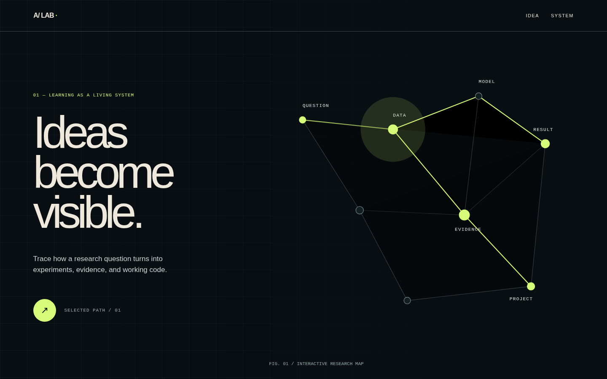
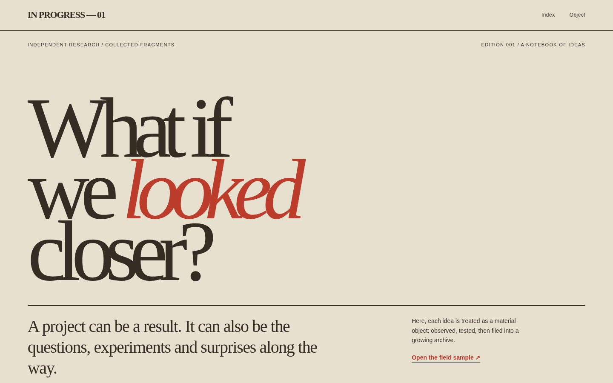

# Aestitch · Suatlora 出品

**发现审美，探索真正不同的创意方向，并减少从设计到代码的表达损失。**

> **v0.3.0 预览版**：这是一套 Agent Skill + 本地 Python 工具。它不会自动变成艺术总监，也不会凭网站链接直接生成优秀的原创设计。它提供真实页面采集、视觉原型对照和跨模型交接证据，让 Codex 等 Agent 的设计工作可以被观察与验证。

## 为什么改版？

上一轮 A/C 对照实验里，无 Skill 与 Aestitch 都做出了比较规整的作品集，但未能达到用户希望的视觉特色。继续改颜色、调网格和追加动效没有解决问题。v0.3 把工作重心移到设计之前的三个环节：**观察参考 → 探索原创艺术方向 → 验证设计实现**。

## 新功能

| 功能 | 可以做 | 不能做 |
|---|---|---|
| `observe capture/report` | 使用真实 Chromium 截图，记录不同滚动位置、字体、元素大小和位置、交互控件概况 | 自动理解设计情绪、完整录制复杂动效或 WebGL 效果 |
| `concept add/render/compare` | 存储独立 HTML 创意原型，检查两套方案是否只改了颜色/文案/细节 | 自己发明漂亮原型或判断哪套最好看 |
| `fidelity` | 对比原型与实际实现的截图和 DOM 几何证据 | 代替人工验收交互和整体艺术效果 |
| `guard --top-viewport` | 全页高度变化时，仍比较页面顶部同一视口 | 自动检查所有下方模块 |
| `taste compare --relative-preference ... --acceptance ...` | 记录“两套都不满意，但 C 稍好”这类复杂反馈 | 根据一次选择永久定义用户风格 |

v0.2 的 `reference`、`taste`、`contract`、`scope` 和旧视觉截图工具仍然保留。`.aestitch/` 默认由 Git 忽略，不上传个人截图或偏好。

## Windows 更新步骤

你已经在 `F:\Projects\Aestitch-skill` 安装过 v0.2，因此**不需要重新克隆**：

```powershell
cd F:\Projects\Aestitch-skill
git pull --ff-only
uv sync --extra all
uv run python -m playwright install chromium
uv run aestitch doctor
```

如果 C 组曾经**复制**了 Skill，则仍需手动同步其项目目录（请先检查有没有个人修改）：

```powershell
Copy-Item "F:\Projects\Aestitch-skill\skills\aestitch\*" `
 "F:\Projects\aestitch-lab-c\.agents\skills\aestitch" -Recurse -Force
```

测试阶段继续只操作实验项目，不要直接改变正式 Suatlora 网站。

## 实际浏览器截图（演示，不是审美评分）

| 空间研究网络 | 字体主导的实验性编辑页面 |
|---|---|
|  |  |

这两个案例只是验证独立设计概念和采集管线。你可以都不喜欢，工具不会因此给你强加风格标签。

## 先体验：两套原创原型

仓库自带两份演示 HTML：一套深色的空间研究网络，一套暖色的实验性字体版面。它们只是用于验证流程的**原创演示作品**，不是应该套用到个人网站的固定设计模板。

从 `F:\Projects\Aestitch-skill` 执行：

```powershell
uv run aestitch init
uv run aestitch concept add --id spatial --title "Computational space" --thesis "Research as navigable space" --mechanism "Interactive research network" --html-file examples/creative-lab/computational-space.html
uv run aestitch concept add --id editorial --title "Editorial object" --thesis "Research as printed notes" --mechanism "Oversized typography and resampling" --html-file examples/creative-lab/editorial-object.html
uv run aestitch concept render --id spatial
uv run aestitch concept render --id editorial
uv run aestitch concept compare --left spatial --right editorial
```

截图保存在 `.aestitch/observations/concept-spatial/` 和 `.aestitch/observations/concept-editorial/`；比较结果在 `.aestitch/reports/`。注册时不会覆盖已有同名原型，想重新试请使用新的 ID。

## 实际观察自己的 Next.js 网站

先运行 Next.js 开发服务器，再用下列命令对**本地**页面采集证据（端口需换成你实际运行的端口）：

```powershell
uv run --project F:\Projects\Aestitch-skill aestitch --root F:\Projects\aestitch-lab-c observe capture --id my-home --url http://127.0.0.1:3000 --viewport both --steps 3
uv run --project F:\Projects\Aestitch-skill aestitch --root F:\Projects\aestitch-lab-c observe report --id my-home
```

外部站点只能在明确允许后使用 `--allow-remote`，且默认阻止其他主机的资源，因此 CDN、跨域字体、WebGL 素材可能缺失。对于 Psychoactive、Orchestrated 等复杂交互网站，仍需要浏览器里实际操作与录屏，不能靠静态截图谎称已经理解所有动效。

## 下一步怎样使用

让 Codex 阅读更新后的 `SKILL.md`，先保留旧 Field Notes，再独立创作至少两套**真正不同的首屏交互原型**，保存证据后交给你选择。用户没有满意之前，不允许自动批准设计契约，也不要直接扩建整站。成功运行、构图差异明显**不等于**审美优秀。

更多命令和限制见 [English README](README.md)、[Agent Skill](skills/aestitch/SKILL.md) 和 [创意实验说明](examples/creative-lab/README.md)。


## 谁负责改 Skill？谁负责做实验？

Aestitch 的**正式源码只维护在本仓库**。开发者/Skill 维护者负责读取实验结论、修改 GitHub 源码、回归测试和发布；用户本地运行的 Codex、Claude Code、DeepSeek 等 Agent 只负责在隔离实验环境中制作原型、采集截图和记录测试结果。实验网页不是本产品，不应该长期偏离 Skill 开发主线。

v0.3 增加了`experiment` 交接命令，用于把本地 AI 的运行结果整理成可交给维护者检查的证据包。文件不被上传，记录放在目标实验的 `.aestitch/experiments/` 目录。

```powershell
# 在实验项目根目录运行；只登记已经存在的本地证据
uv run --project F:\Projects\Aestitch-skill aestitch experiment record --id creative-01 --agent "Claude Code" --model "DeepSeek V4 Pro" --skill-version "0.3.0" --task "BFS 两种原创交互方案" --result "两套可运行原型；尚待用户评审" --artifact "prototypes/search-field.html" --artifact "prototypes/before-arrival.html"
uv run --project F:\Projects\Aestitch-skill aestitch experiment report --id creative-01
```

注意：上述命令的工作目录必须是**实际包含原型的实验项目**。如果原型还没被用户接受，就保持 `unreviewed`，不要伪造 `review`、不要自动批准 Design Contract，也不要在实验仓库修改正式 Skill。
